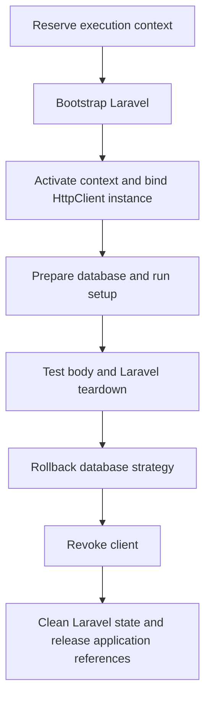

# ADR 0001: A typed HTTP client for Laratesto

Status: accepted and implemented in [PR #39](https://github.com/ichinya/laratesto/pull/39).
Date: 2026-10-20. Research: [issue #36](https://github.com/ichinya/laratesto/issues/36).

## Context and alternatives

Laravel tests should be able to make HTTP requests without extending
`LaravelTestCase` or using `InteractsWithLaravel`. The existing helpers must keep
working and share one implementation and one request state.

| API | Convenience and static analysis | Testing and Testo integration | Maintenance |
| --- | --- | --- | --- |
| `Laratesto::get('/users')` | Shortest call; explicit wrappers preserve types, while magic dispatch obscures the API. | Still needs an execution-bound client behind the static calls. | Adds a static entry point for every request/configuration helper. |
| `Laratesto::http()->get('/users')` | One extra call; a concrete return type exposes real methods to completion and analysis. | Resolves the current execution's client; helpers can also accept that client explicitly. | One static accessor, one HTTP implementation. **Chosen.** |
| `app(HttpClient::class)->get('/users')` | More explicit service lookup; the client has the same typed methods. | Resolves the same instance after bootstrap; does not require a separate facade implementation. | Supported alongside `http()`, using one container binding. |

All three options need the same application lifecycle rules. Choosing a shorter
call syntax does not make a process-wide cached application safe.

## Decision and API

Expose `Laratesto\Laratesto::http(): Laratesto\Testing\HttpClient`. This is an
explicit static accessor, without Laravel Facade root caching or magic forwarding.
There is no `Laratesto::get()` shorthand.

Register `LaravelPlugin` for the suite, then use the accessor in a test:

```php
use Laratesto\Laratesto;
use Laratesto\Testing\HttpClient;
use Testo\Assert;
use Testo\Test;

#[Test]
function containerAndAccessorShareAClient(): void
{
    Assert::same(Laratesto::http(), app(HttpClient::class));
}
```

The public client covers HTTP verbs, JSON requests, headers/tokens, cookies,
session values, server variables and redirect following. It returns the existing
`LaravelResponse`. Authentication helpers, middleware controls, database
assertions and Artisan helpers remain on the existing base class/trait.

The trait delegates request state and dispatch to the client. Shared request
methods preserve the protected legacy signatures and dispatch through legacy
`sendRequest()` overrides, including followed redirects.

## Execution lifecycle



`HttpTestContext` owns one client per actual execution, including each Retry or
Repeat attempt. It binds that instance into the current application after
bootstrap. The accessor, container and legacy helpers share headers, cookies,
session overrides and redirect settings within that execution.

The context is closed on success and all failure paths, before application
disposal. An old client cannot switch to a later application's container, and a
retained client does not retain its former application. Replacing Laravel's global
container externally is rejected. Reserving the context before bootstrap rejects
nested Laravel executions before they can boot or clean the outer application.

Access outside a LaravelPlugin execution or during bootstrap raises an explicit
exception. Execution is sequential; native Fiber Solo is supported, interleaved
Laravel test scheduling is not. Do not resolve the client in a test constructor
or keep it for a later execution.

## Compatibility and acceptance evidence

The root package remains independent of `phpunit/phpunit`. Consumers can install
real PHPUnit alongside Testo, but this accessor requires a Testo LaravelPlugin
execution and is not an HTTP API for tests run by PHPUnit itself.

Acceptance requires shared state across the three access paths; fresh state for
retries, repeats and separate suites; rejection of expired clients, nested
executions and application swaps; cleanup after boot, injection, setup, body and
cleanup errors; and preservation of the primary failure.

These scenarios are covered by
[`HttpClientContextTest`](../../tests/Unit/HttpClientContextTest.php),
[`HttpClientCompatibilityTest`](../../tests/Unit/HttpClientCompatibilityTest.php)
and the [real PHPUnit consumer](../../tests/Consumer/http-client/README.md).
Local Unit/Laravel/Rector suites and the real PHPUnit consumer passed across
the supported PHP matrix.
[CI for the implementation](https://github.com/ichinya/laratesto/actions/runs/39433771303)
also passed its required PHP and coverage jobs. Its experimental PHP job
stopped at the existing `nette/schema` platform constraint, before tests.

## Future decisions

Additional clients for authentication, Artisan or database helpers need separate
API and lifecycle decisions. Automatic injection into Testo function parameters
and concurrent Laravel applications are outside this decision. None is required
to use the HTTP accessor.

Laravel's [instance binding documentation](https://laravel.com/docs/container#binding-instances)
describes the container mechanism; `HttpTestContext` supplies the execution
boundary and revocation that the binding alone does not provide.
